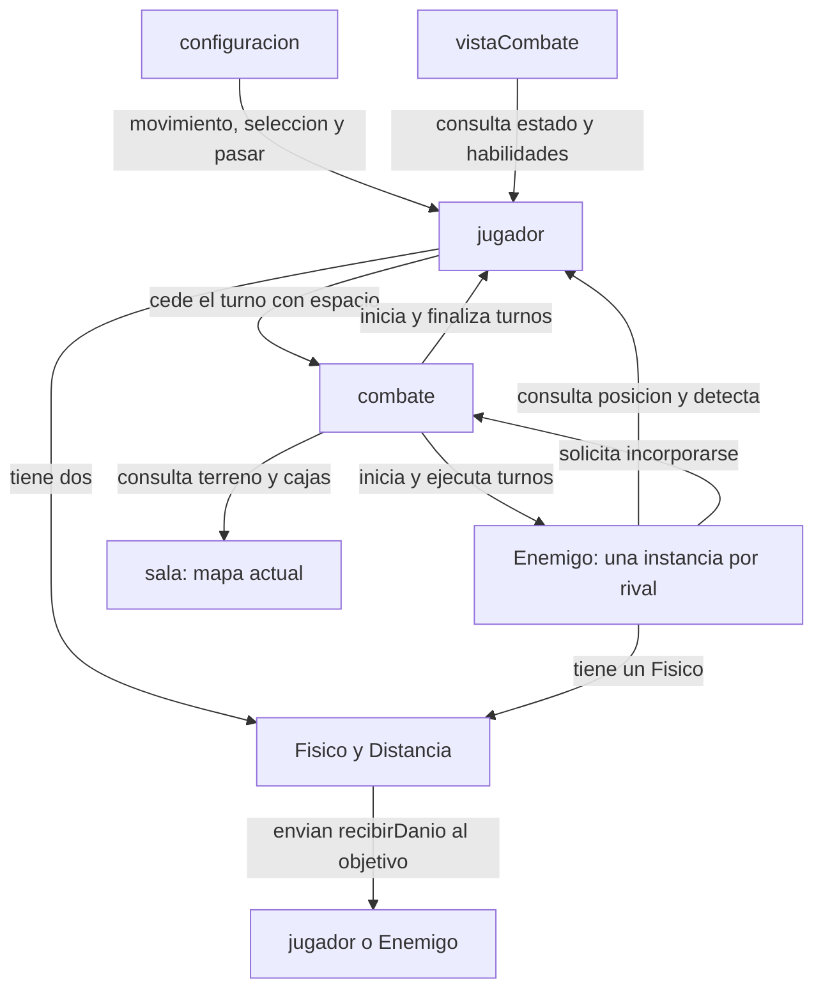
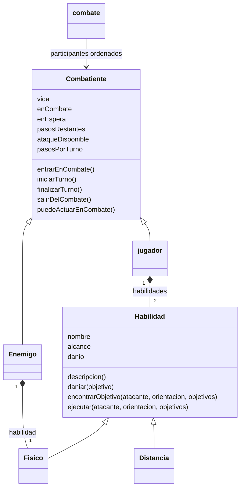

# Combate tactico

El enemigo consulta la posicion del jugador cada 250 ms. Si la distancia por
casillas (Manhattan) es menor que 5, solicita incorporarse al combate.
La sala aporta el mapa y presenta los enemigos; la deteccion pertenece al enemigo.

## Objetos y relaciones



## Clases y estado compartido



`jugador` y `combate` son objetos unicos. `Combatiente`, `Enemigo`,
`Habilidad`, `Fisico` y `Distancia` son clases. El jugador hereda de
`Combatiente`, igual que cada instancia de `Enemigo`.

## Turnos

`combate` guarda una lista `[jugador, enemigo1, enemigo2, ...]` y un indice
`turnoActual`. No reemplaza los booleanos de los participantes: les envia
mensajes para que cada uno cambie su propio estado.

| Situacion | enCombate | enEspera |
|---|---|---|
| Explorando | false | false |
| Esperando turno | true | true |
| Jugando su turno | true | false |

Cada turno repone 3 pasos y un ataque. Agotar esos recursos no termina el
turno del jugador: solo espacio lo termina. Los enemigos juegan automaticamente
y devuelven el control al siguiente participante. Los derrotados permanecen en
la lista hasta finalizar el encuentro, pero se saltean al avanzar el indice.
Un enemigo que se incorpora durante una pelea queda en espera y no repone los
recursos del jugador.

El movimiento enemigo se muestra casilla por casilla, con 220 ms entre pasos.
El turno permanece en el enemigo mientras camina; al terminar el recorrido
intenta atacar y solicita avanzar al siguiente participante. Los pasos pendientes
se invalidan al salir del combate o reiniciar la partida.

## Metodos principales

| Objeto | Metodo | Comportamiento |
|---|---|---|
| jugador | `moverA(destino, siguiente, orientacion)` | Si hay habilidad seleccionada, ataca; si no, valida el movimiento y descuenta un paso cuando corresponde. |
| jugador | `puedeMoverA(destino, siguiente)` | Evita enemigos. Durante el combate, tambien evita cajas sin empujarlas; explorando conserva las reglas del puzzle. |
| jugador | `seleccionarHabilidad(numero)` | Guarda una de sus dos habilidades cuando puede atacar. |
| jugador | `atacar(orientacion)` | Ejecuta la seleccion y consume el ataque solo si alcanza un objetivo. Limpia la seleccion y comprueba el final del combate. |
| jugador | `pasarTurno()` | Limpia la seleccion y pide avanzar el turno. |
| Enemigo | `detectarJugador()` | Comprueba vida, estado de partida y distancia; solicita incorporarse si corresponde. |
| Enemigo | `aparecer()` | Registra al enemigo, agrega su imagen y programa su deteccion periodica. Cada enemigo de la escena tiene un identificador de evento distinto. |
| Enemigo | `jugarTurno()` | Inicia una nueva secuencia de movimiento y programa sus pasos. |
| Enemigo | `acercarseAlJugador()` | Programa hasta 3 pasos separados por 220 ms y la finalizacion del turno. |
| Enemigo | `darPaso(destino, version)` | Avanza una casilla si el turno sigue vigente, esta vivo y el destino sigue libre; descuenta un paso. |
| Enemigo | `completarTurno(version)` | Intenta atacar y solicita avanzar el turno. Si murio durante el recorrido, tambien permite continuar la pelea. |
| Enemigo | `atacarSiEstaAlLado()` | Aplica una mordida de 1 de dano si queda a distancia 1, sin diagonales. |
| combate | `incorporar(enemigo)` | Inicia la lista con el jugador si hace falta y agrega al enemigo sin duplicarlo. |
| combate | `avanzarTurno()` | Pone al actual en espera, avanza circularmente, saltea muertos e inicia el siguiente. |
| combate | `caminoAlJugador(origen)` | Busca por anchura un camino sin atravesar paredes, cajas, otros enemigos ni al jugador. Si no existe, devuelve solo el origen. |
| combate | `verificarFinal()` | Finaliza al morir el jugador o al no quedar enemigos vivos entre los participantes. |
| combate | `finalizar()` / `reiniciar()` | Limpia participantes y estados; el reinicio tambien elimina el registro de enemigos de la sala anterior. |
| Habilidad | `encontrarObjetivo(...)` | Recorre casillas en la direccion elegida, hasta el alcance; paredes y cajas bloquean el ataque. |
| Habilidad | `daniar(objetivo)` | Envia `recibirDanio(danio)` al objetivo; concentra la responsabilidad de aplicar el dano. |
| Habilidad | `ejecutar(...)` | Busca el primer objetivo, delega en `self.daniar(objetivo)` y devuelve si acerto. El enemigo tambien delega en `habilidad.daniar(jugador)`. |
| vistaCombate | `text()` | Muestra combate, turno, pasos, vida, ataque disponible, habilidades con alcance/dano y controles. |

## Habilidades y controles

| Personaje | Habilidad | Alcance | Dano |
|---|---|---|---|
| jugador | Golpe | 1 | 2 |
| jugador | Disparo | 3 | 1 |
| Enemigo | Mordida | 1 | 1 |

- Flechas: movimiento; con una habilidad seleccionada, eligen la direccion del ataque sin mover al jugador.
- 1 / 2: seleccionar habilidad. Puede cambiarse la seleccion antes de atacar.
- Espacio: terminar el turno voluntariamente.
- R: reiniciar la partida.
- Los controles del puzzle y la interaccion con E quedan suspendidos durante el combate.

Los dos enemigos aparecen al restaurar la luz en la segunda sala. Fuera del
radio de deteccion permanecen quietos. Una vez incorporados, alejarse no cancela
el combate. Al ganar, desaparecen los derrotados y se recupera la exploracion.

## Verificacion

Al recibir dano, el jugador y los enemigos supervivientes parpadean dos veces:
sprite visible, transparente, visible, transparente y visible, con intervalos de
120 ms. El efecto dura 480 ms y conserva las colisiones y la posicion. Un golpe
nuevo reinicia el efecto; reiniciar el jugador invalida los cambios pendientes.
El escudo evita el parpadeo cuando absorbe el golpe. Los enemigos derrotados se
retiran del tablero sin que el efecto pueda agregarlos otra vez.

```powershell
wollok.cmd test -p ./ -f tests/combateTactico.wtest
wollok.cmd test -p ./ -f tests/testExample.wtest
wollok.cmd test -p ./ -f tests/parpadeo.wtest
```

La carpeta `mini-tps-objetos-2026-skinnieraxis1` se uso como referencia de estilo;
contiene ejercicios con fallos previos y no se modifica con esta funcionalidad.

Fallos preexistentes observados antes de implementar:

| Archivo de referencia | Prueba |
|---|---|
| tp2/tests_tp2.wtest | El total a abonar cuando el carrito esta vacio es 0 |
| tp2/tests_tp2.wtest | El total a abonar cuando el carrito tiene varios productos es la suma de los precios de los productos que se agregaron |
| tp2/tests_tp2.wtest | Si un producto se agrega mas de una vez, se ve reflejado en el total a abonar |
| tp2/tests_tp2.wtest | El producto mas caro del carrito cuando tiene productos es el que tiene mayor precio final |
| tp2/tests_tp2.wtest | No se puede conocer el producto mas caro cuando el carrito esta vacio |
| tp3/tests_tp3.wtest | CAMBIAME |
