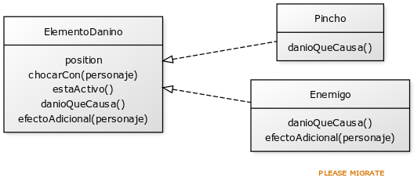
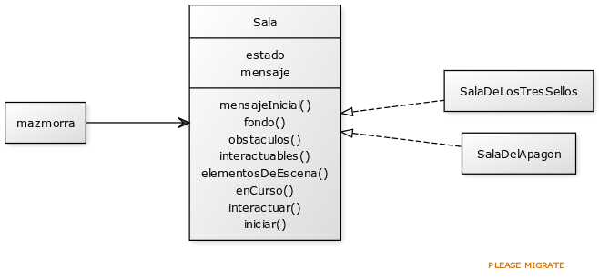

# Explicaciones teóricas

## Conceptos ya aplicados (Checkpoint 1)

- **Polimorfismo**: `sala.interactuar()` manda el mensaje `interactuar(jugador)` al
  interactuable más cercano sin preguntar de qué tipo es. `Boton`, `ObjetoRecogible`
  y `salida` responden cada uno a su manera (activar el puzzle, guardarse en el
  inventario, o validar si el jugador tiene la llave).
- **Delegación**: `sala` no resuelve el puzzle, le delega a `puzzle` cuándo un botón
  fue presionado en el orden correcto. `puzzle` a su vez delega en cada `Boton` el
  prenderse o no.

## Conceptos en desarrollo (Checkpoint 2)

- **Herencia + Template Method en `Sala`**: `Sala` pasó de ser un objeto único a una
  clase abstracta con el flujo general del juego (`iniciar()`, `permitePasar()`,
  `interactuar()`, `ganar()`, `perder()`). Cada sala concreta solo redefine los
  hooks: `mensajeInicial()`, `fondo()`, `obstaculos()`, `interactuables()`,
  `elementosDeEscena()`, y opcionalmente `alMoverse()`, `movimientoBloqueado()`,
  `puedeAvanzarA()`. Hay dos subclases, `SalaDeLosTresSellos` y `SalaDelApagon`. Un
  objeto `mazmorra` sostiene cuál es la sala actual y resuelve la transición entre
  ambas. Ver diagrama [Sala](assets/diagramas/Sala.png).
- **Herencia + Template Method en `ElementoDanino`**: clase base de todo lo que
  puede lastimar al jugador. Define el flujo común (`chocarCon`) y deja como hooks
  abstractos lo que cada subclase decide (`danioQueCausa`, `efectoAdicional`).
  `Pincho` (daño fijo, estático) es una subclase concreta ya implementada;
  `Enemigo` (daño propio, se mueve) todavía no. Ver diagrama
  [ElementoDanino](assets/diagramas/ElementoDanino.png).
- **Colisiones propias de Wollok Game**: se reemplaza el chequeo manual de posición
  por `game.onCollideDo`, para que el motor avise cuándo el jugador choca con un
  `ElementoDanino`. Ya en uso para `Pincho`.
- **Eventos temporales**: se usa `game.schedule(...)` para la expiración automática
  del escudo del jugador. El movimiento del `Enemigo` va a usar `game.tick(...)`,
  el tercer tipo de bloque de configuración de eventos (junto a teclado y
  colisión).
- **Bloques como parámetros**: además de los eventos de teclado y colisión, se usan
  bloques para inyectar comportamiento sin acoplar clases. `PanelDeCables(pares,
  alResolver)` resuelve el minijuego de cables sin saber qué pasa después.
  `Salida(condicion, alCruzar)` sirve tanto para "necesitás la llave" como para
  "las tres losas están pisadas", porque la condición y la acción al cruzar son
  bloques que le pasa cada sala.
- **Colecciones**: listas de obstáculos, botones, inventario, cables y losas se
  manejan de forma declarativa (`filter`, `map`, `forEach`, `any`, `all`), evitando
  lógica repetida por cada elemento.

# Diagramas

